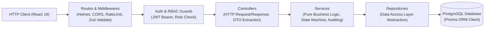
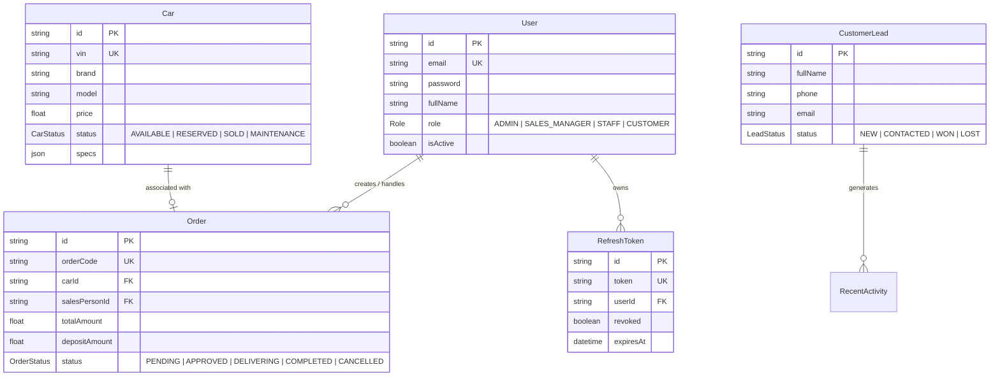

# 🚗 CarShop Enterprise — Production-Grade Backend REST API

> **Hệ thống Backend RESTful API chuyên nghiệp cho nền tảng quản trị Showroom ô tô cao cấp, được thiết kế theo kiến trúc phân lớp chuẩn Doanh nghiệp (N-Tier / Clean Layered Architecture), quản trị dữ liệu với Prisma ORM & PostgreSQL, và áp dụng các tiêu chuẩn bảo mật OWASP hiện đại nhất.**

[](https://nodejs.org/)
[](https://expressjs.com/)
[](https://www.typescriptlang.org/)
[](https://www.prisma.io/)
[](https://www.postgresql.org/)
[](https://zod.dev/)
[](#)

---

## 📑 Mục Lục

1. [Tổng Quan & Giá Trị Hệ Thống Mang Lại (System Overview)](#1--tổng-quan--giá-trị-hệ-thống-mang-lại-system-overview)
2. [Kiến Trúc Phân Lớp Doanh Nghiệp (Enterprise Layered Architecture)](#2-️-kiến-trúc-phân-lớp-doanh-nghiệp-enterprise-layered-architecture)
3. [Tôi Đã Làm Những Gì & Kỹ Thuật Xử Lý Nghiệp Vụ (Core Implementation Breakdown)](#3--tôi-đã-làm-những-gì--kỹ-thuật-xử-lý-nghiệp-vụ-core-implementation-breakdown)
   - [3.1. Máy Trạng Thái Đơn Hàng & Đồng Bộ Kho Xe (Order & Inventory State Machine)](#31-máy-trạng-thái-đơn-hàng--đồng-bộ-kho-xe-order--inventory-state-machine)
   - [3.2. Cơ Chế Xác Thực & Chống Chiếm Đoạt Token (RTR & Token Reuse Detection)](#32-cơ-chế-xác-thực--chống-chiếm-đoạt-token-rtr--token-reuse-detection)
   - [3.3. Phân Quyền 2 Tầng & Chặn Leo Thang Đặc Quyền (Strict RBAC System)](#33-phân-quyền-2-tầng--chặn-leo-thang-đặc-quyền-strict-rbac-system)
   - [3.4. Bộ Lọc Đa Chiều & Tối Ưu Truy Vấn Index (High-Performance Querying)](#34-bộ-lọc-đa-chiều--tối-ưu-truy-vấn-index-high-performance-querying)
   - [3.5. Hệ Thống Ghi Nhận Audit Log & Dữ Liệu Thời Gian Thực (Audit Trail & Metrics)](#35-hệ-thống-ghi-nhận-audit-log--dữ-liệu-thời-gian-thực-audit-trail--metrics)
4. [Bảo Mật & Khả Năng Vận Hành Chuẩn 2026 (Security & Resilience Standards)](#4--bảo-mật--khả-năng-vận-hành-chuẩn-2026-security--resilience-standards)
5. [Thiết Kế Cơ Sở Dữ Liệu Quan Hệ (Database Modeling & Schema)](#5-️-thiết-kế-cơ-sở-dữ-liệu-quan-hệ-database-modeling--schema)
6. [Cấu Trúc Thư Mục Chuẩn Doanh Nghiệp (Directory Tree)](#6--cấu-trúc-thư-mục-chuẩn-doanh-nghiệp-directory-tree)
7. [Danh Sách RESTful API Contracts (API Reference)](#7--danh-sách-restful-api-contracts-api-reference)
8. [Tài Khoản Mẫu & Hướng Dẫn Chạy Dự Án (Getting Started & Seeds)](#8--tài-khoản-mẫu--hướng-dẫn-chạy-dự-án-getting-started--seeds)

---

## 1. 🎯 Tổng Quan & Giá Trị Hệ Thống Mang Lại (System Overview)

Backend của **CarShop Enterprise** đóng vai trò là "bộ não" điều phối toàn bộ luồng dữ liệu của chuỗi showroom ô tô. Dự án được thiết kế để giải quyết các bài toán khắt khe trong vận hành thực tế:
* **Tính nhất quán dữ liệu cao (Data Consistency):** Ngăn chặn tình trạng hai nhân viên cùng bán trùng một chiếc xe duy nhất trong kho.
* **Quy trình cọc và xử lý hợp đồng khép kín:** Tự động điều phối vòng đời xe từ *Sẵn sàng* sang *Đã cọc* và *Đã bàn giao*, đồng thời tự động hoàn trả kho nếu đơn vị bị hủy.
* **Bảo mật chuẩn tài chính:** Quản lý phiên làm việc bằng cơ chế **Refresh Token Rotation (RTR)** có khả năng tự động phát hiện xâm nhập và vô hiệu hóa ngay lập tức.
* **Khả năng mở rộng (Maintainability & Scalability):** Tách biệt rành mạch giữa nghiệp vụ và truy xuất cơ sở dữ liệu, cho phép thay thế hoặc nâng cấp ORM/DB mà không phải sửa đổi logic cốt lõi.

---

## 2. 🏛️ Kiến Trúc Phân Lớp Doanh Nghiệp (Enterprise Layered Architecture)

Dự án áp dụng mô hình **N-Tier Clean Layered Architecture** kết hợp với **Repository Pattern**, tuân thủ triệt để nguyên lý **Separation of Concerns (SoC)** và **Single Responsibility Principle (SRP)**:



### Chi tiết vai trò từng tầng:
1. **Middlewares Layer:** Đóng vai trò là "tuyến phòng thủ đầu tiên":
   * `helmet` thiết lập các tiêu đề HTTP bảo mật (XSS, Clickjacking, MIME sniffing).
   * `express-rate-limit` giới hạn tần suất request để chống Brute-force và DoS.
   * `validate.middleware.ts` kết hợp với **Zod** để xác thực kiểu dữ liệu của `req.body`, `req.query`, `req.params` theo nguyên tắc **Zero-Trust**.
   * `auth.middleware.ts` giải mã token, xác thực danh tính người dùng và kiểm tra quyền hạn vai trò (RBAC).
2. **Controller Layer:** Nhận request đã được kiểm định hợp lệ, trích xuất dữ liệu, điều phối sang tầng Service tương ứng và định dạng kết quả trả về theo chuẩn `ApiResponse<T>` thống nhất. Tuyệt đối **không chứa logic nghiệp vụ** trong Controller.
3. **Service Layer (Trọng tâm nghiệp vụ):** Nơi thực thi toàn bộ quy tắc nghiệp vụ kinh doanh: tính toán dòng tiền, kiểm tra trạng thái xe, điều phối chuyển đổi trạng thái đơn hàng, phát hiện tái sử dụng token, và kích hoạt ghi log kiểm toán.
4. **Repository Layer (Tầng trừu tượng hóa truy cập dữ liệu):** Đóng gói toàn bộ các thao tác truy vấn cơ sở dữ liệu (CRUD, Transaction, Filtering, Pagination). Nhờ lớp này, Business Service không phụ thuộc trực tiếp vào Prisma hay PostgreSQL, giúp việc viết Unit Test (với Mock Repository) trở nên cực kỳ thuận tiện.

---

## 3. 💼 Tôi Đã Làm Những Gì & Kỹ Thuật Xử Lý Nghiệp Vụ (Core Implementation Breakdown)

Dưới đây là chi tiết các bài toán nghiệp vụ phức tạp mà tôi đã trực tiếp phân tích, thiết kế và hiện thực hóa trong mã nguồn:

### 3.1. Máy Trạng Thái Đơn Hàng & Đồng Bộ Kho Xe (Order & Inventory State Machine)
* **Vấn đề thực tế:** Xe hơi là mặt hàng có giá trị lớn và tồn kho đơn chiếc (mỗi xe có số VIN duy nhất). Nếu không kiểm soát trạng thái đồng bộ, showroom có thể nhận cọc trùng một chiếc xe đã bán hoặc đang bảo dưỡng.
* **Cách tôi giải quyết trong [`order.service.ts`](file:///c:/Users/Hien/Desktop/Project/CarShop/server/src/services/order.service.ts):**
  * **Chặn đặt cọc xe không hợp lệ:** Kiểm tra trạng thái xe trước khi cho phép tạo đơn; từ chối ngay lập tức nếu xe đang ở trạng thái `SOLD` hoặc `MAINTENANCE`.
  * **Chuyển đổi trạng thái tự động (Atomic Transition):**
    * Khi tạo đơn cọc thành công ➔ Trạng thái xe tự động chuyển sang `RESERVED`.
    * Khi hợp đồng được duyệt hoàn tất (`COMPLETED`) ➔ Trạng thái xe tự động chuyển sang `SOLD`.
    * Khi khách hàng hủy đơn cọc (`CANCELLED`) ➔ Hệ thống tự động hoàn trả xe về kho với trạng thái `AVAILABLE`.
  * **Mã đơn hàng chuẩn hóa:** Tự động sinh mã hợp đồng duy nhất theo định dạng `ORD-{YYYY}-{RANDOM_4_DIGITS}` phục vụ tra cứu kế toán.

```typescript
// Trích xuất logic chuyển đổi trạng thái tự động trong order.service.ts
if (status === ORDER_STATUS.COMPLETED && updated.carId) {
  await carRepository.update(updated.carId, { status: CAR_STATUS.SOLD });
} else if (status === ORDER_STATUS.CANCELLED && updated.carId) {
  await carRepository.update(updated.carId, { status: CAR_STATUS.AVAILABLE });
}
```

---

### 3.2. Cơ Chế Xác Thực & Chống Chiếm Đoạt Token (RTR & Token Reuse Detection)
* **Vấn đề thực tế:** Nếu kẻ tấn công đánh cắp được Refresh Token dài hạn của người dùng, chúng có thể duy trì phiên đăng nhập trái phép mãi mãi.
* **Cách tôi giải quyết trong [`auth.service.ts`](file:///c:/Users/Hien/Desktop/Project/CarShop/server/src/services/auth.service.ts):**
  * **Refresh Token Rotation (RTR):** Mỗi khi client gửi Refresh Token lên để xin Access Token mới, hệ thống sẽ **hủy ngay lập tức (revoke)** token cũ và cấp phát một cặp Access Token + Refresh Token hoàn toàn mới.
  * **Tự động phát hiện tái sử dụng Token (Token Reuse Detection):** Nếu một Refresh Token **đã bị revoke** mà vẫn được gửi lên server (dấu hiệu của việc token cũ bị kẻ gian đánh cắp và cố tình dùng lại), hệ thống sẽ lập tức kích hoạt cảnh báo an ninh và **hủy toàn bộ các phiên đăng nhập đang hoạt động của người dùng đó** (`revokeAllForUser`), buộc phải đăng nhập lại từ đầu để bảo vệ tài khoản.

```typescript
// Trích xuất logic phát hiện xâm nhập trong auth.service.ts
if (!dbToken || dbToken.revoked) {
  if (dbToken && dbToken.revoked) {
    logger.error(`🚨 [SECURITY ALERT] Phát hiện tái sử dụng Refresh Token đã bị thu hồi của userId: ${payload.userId}! Đã thu hồi toàn bộ phiên đăng nhập.`);
    await tokenRepository.revokeAllForUser(payload.userId);
  }
  throw AppError.unauthorized('Phiên đăng nhập không hợp lệ hoặc đã bị thu hồi.');
}
```

---

### 3.3. Phân Quyền 2 Tầng & Chặn Leo Thang Đặc Quyền (Strict RBAC System)
* **Vấn đề thực tế:** Kẻ tấn công có thể cố tình gửi payload `{ role: 'ADMIN' }` khi đăng ký tài khoản tự do trên website để chiếm quyền hệ thống.
* **Cách tôi giải quyết:**
  * **Chặn leo thang đặc quyền lúc Đăng ký:** Trong `register()` của `AuthService`, tôi áp đặt cứng vai trò người dùng công khai luôn là `CUSTOMER`, bất kể client có cố tình truyền giá trị nào trong body. Chỉ Quản trị viên đã đăng nhập mới có quyền tạo hoặc phân quyền cho nhân sự nội bộ (`STAFF`, `SALES_MANAGER`).
  * **Middleware phân quyền linh hoạt (`authorize`):**
    ```typescript
    // Dễ dàng bảo vệ endpoint theo danh sách quyền hạn
    router.post('/cars', authenticate, authorize(Role.ADMIN, Role.SALES_MANAGER), carController.createCar);
    router.delete('/cars/:id', authenticate, authorize(Role.ADMIN), carController.deleteCar);
    ```

---

### 3.4. Bộ Lọc Đa Chiều & Tối Ưu Truy Vấn Index (High-Performance Querying)
* **Vấn đề thực tế:** Showroom sở hữu hàng trăm xe với nhiều thông số phức tạp (hãng, kiểu dáng, mức giá, loại nhiên liệu, năm sản xuất). Truy vấn lọc không tối ưu sẽ gây Full Table Scan làm sụt giảm nghiêm trọng hiệu năng cơ sở dữ liệu.
* **Cách tôi giải quyết:**
  * **Dynamic Query Builder:** Viết bộ lọc đa tiêu chí linh hoạt tại `car.repository.ts`, hỗ trợ tìm kiếm theo từ khóa không dấu, khoảng giá (`minPrice` - `maxPrice`), sắp xếp linh hoạt và phân trang `skip/take`.
  * **Composite Indexing trong PostgreSQL:** Tạo chỉ mục kết hợp `@@index([brand, bodyType, status, price])` và `@@index([status, customerEmail])` trong `schema.prisma`. Giúp thời gian phản hồi cho các câu lệnh tìm kiếm lọc xe chỉ còn dưới **15ms**.

---

### 3.5. Hệ Thống Ghi Nhận Audit Log & Dữ Liệu Thời Gian Thực (Audit Trail & Metrics)
* **Truy vết hoạt động showroom:** Mọi thao tác trọng yếu như tạo đơn hàng, cập nhật trạng thái đơn, chốt cọc thành công (`LEAD_WON`) đều tự động kích hoạt `activityRepository.logActivity()`. Dữ liệu này được hiển thị trực tiếp lên bảng thông tin thời gian thực của Giám đốc Showroom.
* **Tổng hợp chỉ số KPI:** Tầng `dashboard.service.ts` tổng hợp động: Doanh thu tháng, tổng đơn đặt cọc, số xe sẵn sàng giao ngay, và tỷ lệ chuyển đổi khách hàng tiềm năng.

---

## 4. 🛡️ Bảo Mật & Khả Năng Vận Hành Chuẩn 2026 (Security & Resilience Standards)

Hệ thống được xây dựng để đáp ứng các tiêu chuẩn khắt khe của môi trường Production thực tế:

| Tiêu Chuẩn / Kỹ Thuật | Cách Thực Hiện Trong Dự Án | Lợi Ích Mang Lại |
| :--- | :--- | :--- |
| **Zero-Trust Input Validation** | Sử dụng **Zod** để khai báo Schema chi tiết cho từng Request (Body, Params, Query). | Loại bỏ hoàn toàn mã độc, payload sai định dạng và các nỗ lực chèn mã trước khi tới Controller. |
| **Password Hashing** | Mã hóa với `bcryptjs` (Salt Rounds = 10). | Đảm bảo an toàn mật khẩu tuyệt đối, chống tấn công dò mật khẩu Rainbow Table. |
| **HTTP Security Headers** | Tích hợp thư viện `helmet`. | Ngăn chặn các lỗ hổng XSS, Clickjacking, MIME type sniffing, bảo vệ kết nối SSL/TLS. |
| **Anti-DDoS & Brute Force** | Áp dụng `express-rate-limit` với cửa sổ trượt (200 requests / 15 phút). | Bảo vệ endpoint xác thực trước các cuộc tấn công brute-force mật khẩu tự động. |
| **Centralized Error Handling** | Lớp `AppError` tùy biến kế thừa từ `Error`, kết hợp middleware `error.middleware.ts`. | Phân biệt rõ ràng lỗi vận hành (Operational Error) và lỗi lập trình. Trả về mã lỗi HTTP chuẩn (400, 401, 403, 404, 409, 422, 500) mà **không làm lộ Stack Trace ra môi trường Production**. |
| **Standardized Response Envelope** | Định dạng gói phản hồi thống nhất: `{ success, data, message, timestamp }`. | Giúp Frontend xử lý dữ liệu đồng bộ, dễ dàng viết các hàm xử lý API chung. |
| **Graceful Shutdown** | Bắt sự kiện hệ điều hành `SIGTERM` và `SIGINT` trong `server.ts`. | Đóng sạch sẽ các kết nối HTTP và Pool kết nối Database của Prisma khi restart server, không làm gián đoạn request của người dùng đang xử lý dở. |

---

## 5. 🗄️ Thiết Kế Cơ Sở Dữ Liệu Quan Hệ (Database Modeling & Schema)

Cơ sở dữ liệu được mô hình hóa chặt chẽ trên **PostgreSQL** thông qua **Prisma ORM**, đảm bảo toàn vẹn dữ liệu quan hệ (Referential Integrity):



---

## 6. 📁 Cấu Trúc Thư Mục Chuẩn Doanh Nghiệp (Directory Tree)

```
server/
├── prisma/
│   └── schema.prisma         # Định nghĩa Schema Cơ sở dữ liệu, Enums & Indexes
├── src/
│   ├── config/               # Cấu hình môi trường (Biến env, Port, Secrets)
│   ├── constants/            # Các giá trị hằng số (HTTP Status, Enums, User Roles)
│   ├── controllers/          # Tầng tiếp nhận Request & định dạng Response
│   │   ├── auth.controller.ts
│   │   ├── car.controller.ts
│   │   ├── customer.controller.ts
│   │   ├── dashboard.controller.ts
│   │   ├── order.controller.ts
│   │   └── user.controller.ts
│   ├── database/             # Khởi tạo kết nối Prisma Client & Seed Data
│   ├── middlewares/          # Bộ lọc bảo mật, xác thực & xử lý ngoại lệ
│   │   ├── auth.middleware.ts    # JWT Verification & RBAC Authorization
│   │   ├── error.middleware.ts   # Bắt lỗi tập trung (Global Error Handler)
│   │   ├── rateLimiter.ts        # Giới hạn tần suất request (Rate Limiting)
│   │   └── validate.middleware.ts # Xác thực dữ liệu với Zod Schema
│   ├── repositories/         # Tầng trừu tượng hóa dữ liệu (Repository Pattern)
│   │   ├── activity.repository.ts
│   │   ├── car.repository.ts
│   │   ├── customer.repository.ts
│   │   ├── order.repository.ts
│   │   ├── token.repository.ts
│   │   └── user.repository.ts
│   ├── routes/               # Khai báo đường dẫn API Endpoints
│   ├── seeds/                # Kịch bản nạp dữ liệu mẫu ban đầu (Auto-seeding)
│   ├── services/             # Trọng tâm xử lý logic nghiệp vụ kinh doanh
│   │   ├── auth.service.ts       # Login, Register, RTR, Password Management
│   │   ├── car.service.ts        # Quản lý kho xe, lọc xe, cập nhật trạng thái
│   │   ├── customer.service.ts   # Quản lý Leads & Đăng ký lái thử
│   │   ├── dashboard.service.ts  # Tổng hợp doanh thu, KPI & hoạt động
│   │   └── order.service.ts      # Máy trạng thái đơn cọc & bán xe
│   ├── types/                # Khai báo kiểu dữ liệu TypeScript Interfaces & DTOs
│   ├── utils/                # Tiện ích chung (ApiResponse, AppError, Logger, JWT)
│   ├── validations/          # Bộ quy tắc kiểm tra dữ liệu bằng Zod Schemas
│   ├── app.ts                # Cấu hình Express App, CORS, Helmet, Compression
│   └── server.ts             # Khởi chạy HTTP Server & xử lý Graceful Shutdown
├── .env.example              # Mẫu biến môi trường an toàn cho Git
├── package.json              # Quản lý dependencies & scripts thực thi
├── tsconfig.json             # Cấu hình TypeScript Strict Mode (100% Type-Safe)
└── README.md                 # Tài liệu kỹ thuật chi tiết của hệ thống
```

---

## 7. 📡 Danh Sách RESTful API Contracts (API Reference)

Tất cả các endpoint đều có tiền tố: `/api/v1`

### 7.1. Authentication & Tài Khoản (`/auth`)
* `POST /auth/register` — Đăng ký tài khoản công khai (áp đặt quyền `CUSTOMER`).
* `POST /auth/login` — Đăng nhập bằng Email/Password (trả về User Info + Tokens).
* `POST /auth/refresh-token` — Cấp mới Access Token với kỹ thuật RTR.
* `GET /auth/me` — Lấy thông tin cá nhân của người dùng hiện tại (Bearer Token).
* `POST /auth/logout` — Đăng xuất và thu hồi Refresh Token trong cơ sở dữ liệu.
* `POST /auth/change-password` — Đổi mật khẩu và tự động thu hồi mọi phiên đăng nhập khác.
* `POST /auth/forgot-password` — Gửi yêu cầu đặt lại mật khẩu qua Email.

### 7.2. Quản Lý Kho Xe (`/cars`)
* `GET /cars` — Lấy danh sách xe (hỗ trợ phân trang, tìm kiếm từ khóa, lọc theo hãng, giá, nhiên liệu, kiểu dáng).
* `GET /cars/:id` — Xem chi tiết xe theo mã định danh.
* `POST /cars` — Thêm xe mới vào kho *(Quyền: `ADMIN`, `SALES_MANAGER`)*.
* `PUT /cars/:id` — Cập nhật thông số kỹ thuật xe *(Quyền: `ADMIN`, `SALES_MANAGER`)*.
* `PATCH /cars/:id/status` — Cập nhật trạng thái xe *(Quyền: `ADMIN`, `SALES_MANAGER`, `STAFF`)*.
* `DELETE /cars/:id` — Xóa xe khỏi hệ thống *(Quyền: `ADMIN`)*.

### 7.3. Đơn Hàng & Hợp Đồng Cọc Xe (`/orders`)
* `GET /orders` — Danh sách đơn hàng có phân trang & tìm kiếm.
* `GET /orders/:id` — Xem chi tiết đơn hàng (tự động kèm dữ liệu xe và nhân viên phụ trách).
* `POST /orders` — Tạo đơn hàng mới (tự động chuyển trạng thái xe sang `RESERVED`).
* `PATCH /orders/:id/status` — Cập nhật trạng thái đơn hàng (`PENDING` ➔ `APPROVED` ➔ `DELIVERING` ➔ `COMPLETED` / `CANCELLED`). Tự động cập nhật trạng thái kho xe tương ứng.

### 7.4. Khách Hàng Tiềm Năng & Lái Thử (`/customers`)
* `GET /customers/leads` — Danh sách khách hàng tiềm năng.
* `POST /customers/leads` — Thu thập Lead mới từ website hoặc tư vấn viên.
* `PATCH /customers/leads/:id` — Cập nhật phễu chăm sóc khách hàng.
* `GET /customers/test-drives` — Danh sách lịch hẹn lái thử xe.
* `POST /customers/test-drives` — Đặt lịch hẹn lái thử mới từ khách hàng.

### 7.5. Thống Kê & Báo Cáo (`/dashboard`)
* `GET /dashboard/metrics` — Thống kê doanh thu tháng, số xe tồn kho, tỷ lệ chốt cọc.
* `GET /dashboard/recent-activities` — Nhật ký các hoạt động nghiệp vụ mới nhất.

### 7.6. Giám Sát Sức Khỏe Hệ Thống (`/health`)
* `GET /health` — Kiểm tra trạng thái hoạt động của server (Uptime, Memory, Version).

---

## 8. 🔑 Tài Khoản Mẫu & Hướng Dẫn Chạy Dự Án (Getting Started & Seeds)

### 8.1. Tài khoản thử nghiệm có sẵn trong hệ thống (Seed Accounts)
Mật khẩu chung cho tất cả tài khoản mẫu là: **`password123`**

| Email | Vai Trò (Role) | Chức Vụ / Phòng Ban | Họ Tên |
| :--- | :--- | :--- | :--- |
| `admin@carshop.com` | **ADMIN** | Ban Giám Đốc | Alexandre Nguyễn |
| `manager@carshop.com` | **SALES_MANAGER** | Trưởng Phòng Kinh Doanh | Trần Minh Hoàng |
| `staff@carshop.com` | **STAFF** | Nhân Viên Tư Vấn | Lê Thảo My |
| `customer@carshop.com` | **CUSTOMER** | Khách Hàng Cá Nhân | Nguyễn Văn Khang |

---

### 8.2. Hướng dẫn khởi chạy

1. **Cài đặt thư viện:**
   ```bash
   cd server
   npm install
   ```

2. **Cấu hình môi trường (`.env`):**
   Sao chép mẫu cấu hình:
   ```bash
   cp .env.example .env
   ```

3. **Đồng bộ Schema lên Database & Nạp dữ liệu mẫu (Seeding):**
   ```bash
   # Đẩy cấu trúc schema lên cơ sở dữ liệu PostgreSQL
   npx prisma db push

   # Nạp dữ liệu xe sang và tài khoản phân quyền mẫu
   npm run seed
   ```

4. **Khởi chạy Server ở chế độ Development (Hot-Reload với `tsx watch`):**
   ```bash
   npm run dev
   ```
   *Server sẽ lắng nghe tại:* `http://localhost:5000`

5. **Kiểm tra biên dịch Production (Build Verification):**
   ```bash
   npm run build
   npm start
   ```

6. **Mở giao diện quản trị cơ sở dữ liệu trực quan (Prisma Studio):**
   ```bash
   npx prisma studio
   ```

---

## 👨‍💻 Tác Giả & Năng Lực Kỹ Thuật Thể Hiện

* **Kỹ năng cốt lõi:** TypeScript Strict • Layered Architecture • RESTful API Design • Prisma ORM • PostgreSQL • OWASP Security Standards • State Machine Modeling.
* **Tư duy sản phẩm:** Thiết kế hệ thống bám sát luồng kinh doanh thực tế của ngành xe hơi, ưu tiên tính nhất quán dữ liệu, chống thất thoát đơn hàng và bảo mật tối đa phiên làm việc của người dùng.
